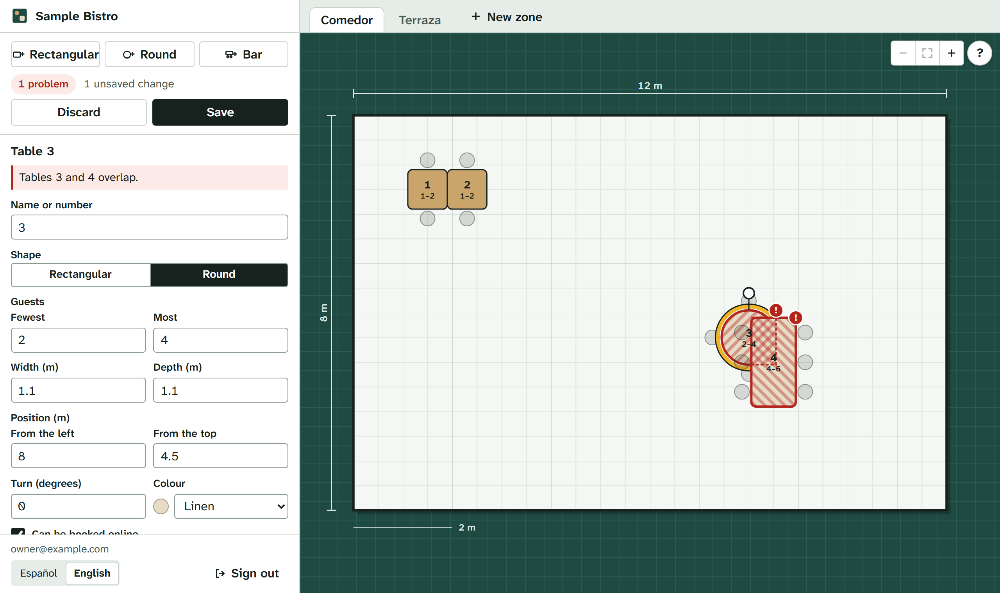
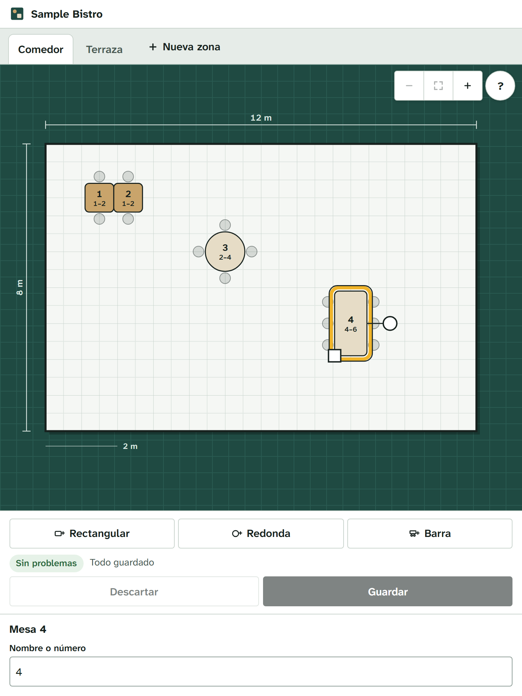
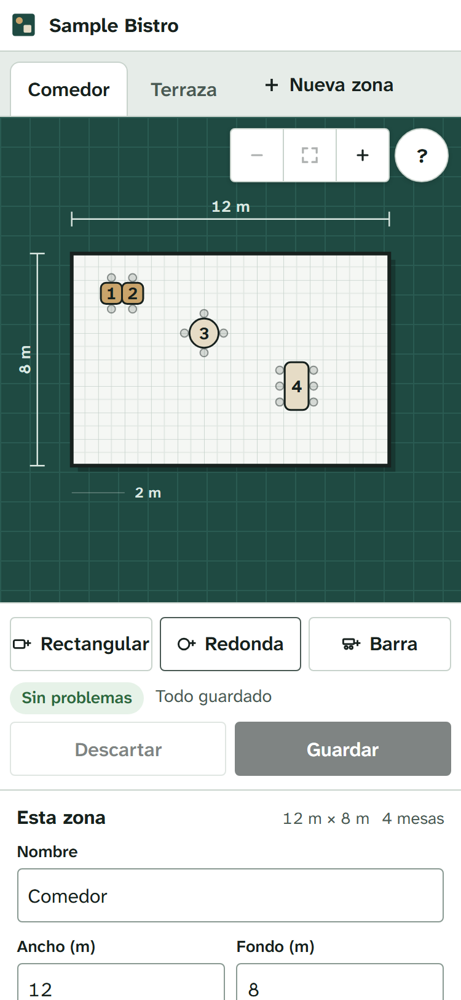
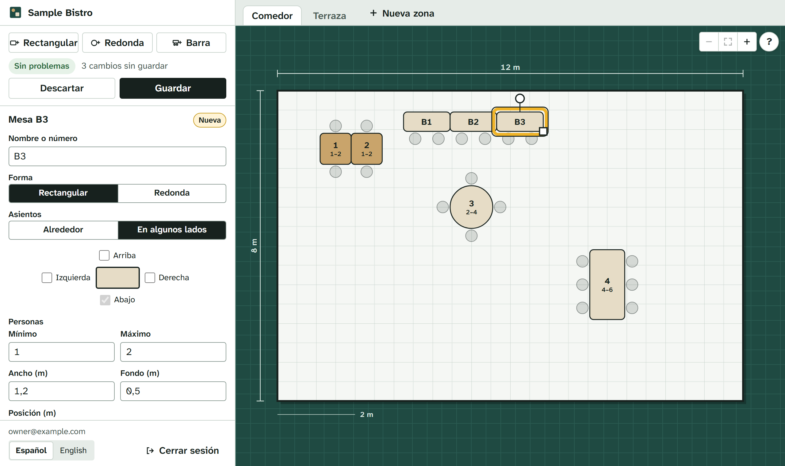
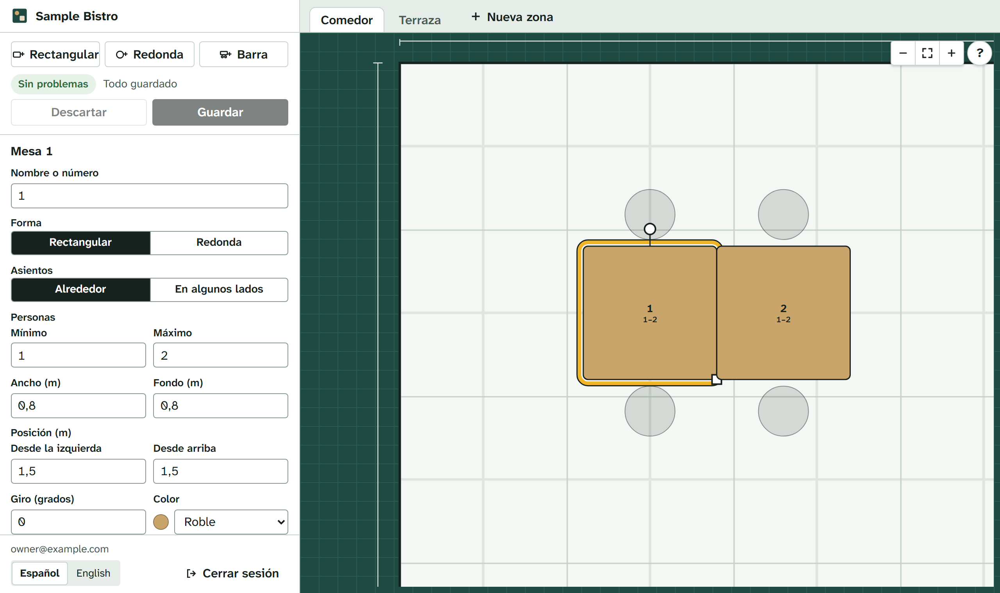

# floorplan-reservations

Reservas de mesa para restaurantes: el local dibuja su propio plano y el motor de reservas trabaja a partir de ese plano.

[Read in English](README.md)

> **Estado: en sus inicios.** La API acepta reservas, la base de datos rechaza las reservas dobles y los propietarios dibujan su plano en un editor en el navegador. Las reservas públicas respetan el horario, la antelación máxima y los límites por dirección. El personal entra con contraseña y solo los propietarios de un local pueden cambiar su plano. Todavía no hay página de reservas ni pantalla del personal. Mira la [hoja de ruta](#hoja-de-ruta).


## Por qué

Muchas herramientas de reservas de código abierto tratan las mesas como una lista: "mesa 4, 4 personas". Pero un comedor no es una lista. Dos mesas pequeñas que están juntas se pueden unir para un grupo de cuatro, y al hacerlo se pierde algún asiento. La mesa de la puerta quizá solo sirve para quien llega sin reserva.

Así que la idea es:

- **El plano manda.** Cada local coloca sus mesas (posición, tamaño, forma, giro, zona, aspecto) y el motor lee esos mismos datos. Si en el plano dos mesas se tocan, el motor puede juntarlas.
- **Cero reservas dobles, y lo garantiza la base de datos.** No un "if" en el código que dos peticiones a la vez pueden saltarse, sino una restricción de PostgreSQL, con tests que lanzan reservas a la vez contra ella.
- **Varios idiomas desde el principio.** Quien reserva lo hace en su idioma y recibe los mensajes en ese idioma. El panel del local está en español por defecto, con inglés disponible.
- **Lo instalas tú.** Un `docker compose up` y funciona. Sin comisiones por cubierto.

Fuera de alcance: comandas, pantallas de cocina, TPV.

## Qué hay hoy

- `packages/engine`: las reglas de reserva, sin base de datos ni red, así que se prueban rápido.
  - `validateZone` revisa el plano: mesas que se pisan, que se salen de la sala o con un número de asientos imposible. Tiene en cuenta el giro.
  - `durationFor` dice cuánto tiempo ocupa la mesa un grupo, según su tamaño.
  - `seatingOptions` dice dónde podría sentarse un grupo, de mejor a peor: la mesa más pequeña en la que cabe y, si no hay, mesas vecinas juntas.
  - `canStillSeat` dice si las mesas que ya tiene un grupo le siguen dando sitio después de cambiar el plano.
  - `acceptsArrival` dice si un cliente puede llegar en una fecha y hora locales, según el horario semanal y los días especiales.
- `apps/api`: una API con [Fastify](https://fastify.dev/) en TypeScript.
  - `GET /venues/:slug/floor-plan` devuelve las zonas y las mesas, más los problemas que el motor encuentra en el plano.
  - `POST /venues/:slug/reservations` reserva mesa. El motor elige la mesa (o mesas) y cuánto tiempo se guarda depende del tamaño del grupo. Responde `409` si no queda nada libre. Mira [límites de las reservas públicas](#límites-de-las-reservas-públicas).
  - `GET` y `PUT /venues/:slug/booking-rules` leen y sustituyen con cuánta antelación se puede reservar y el horario de apertura.
  - Edición del plano: `POST /venues/:slug/zones`, `PATCH` y `DELETE /venues/:slug/zones/:zoneId`, `POST /venues/:slug/zones/:zoneId/tables`, `PATCH` y `DELETE /venues/:slug/tables/:tableId`. Mira [editar el plano](#editar-el-plano).
  - Inicio de sesión del personal: `POST /auth/login`, `POST /auth/logout` y `GET /auth/me`. Mira [cuentas del personal e inicio de sesión](#cuentas-del-personal-e-inicio-de-sesión).
  - `GET /health` comprueba que la API llega a la base de datos.
  - `GET /openapi.json` describe la API (OpenAPI 3.1).
- `apps/web`: el [editor del plano](#el-editor-del-plano) para el personal, en React y TypeScript, construido con Vite. La API lo sirve en `/`.
- `npm run staff`: la línea de comandos que crea el primer propietario y gestiona las cuentas del personal.
- `db/migrations`: el esquema, en archivos SQL normales. Un pequeño programa los aplica en orden, cada uno en su transacción y con un bloqueo para que dos copias de la app no migren a la vez.
- `db/seed/sample.sql`: un local inventado para probar.

## Cómo arrancarlo

### Con Docker

Necesitas Docker con Compose.

```bash
docker compose up --build
```

Después carga el local de ejemplo, crea su propietario (te pide una contraseña) y abre <http://127.0.0.1:3000> para entrar en el editor:

```bash
docker compose exec api node apps/api/dist/seed-cli.js
docker compose exec api node apps/api/dist/staff-cli.js add --venue sample-bistro --email tu@example.com --role owner
```

### Con Node y tu propio PostgreSQL

Necesitas Node 24 o más reciente y PostgreSQL. La CI prueba con PostgreSQL 18; versiones anteriores quizá funcionen, pero no están probadas.

```bash
cp .env.example .env    # y cambia las dos URL de la base de datos
npm install
npm run db:migrate
npm run db:seed
npm run staff -- add --venue sample-bistro --email tu@example.com --role owner
npm run dev       # la API en http://127.0.0.1:3000
npm run dev:web   # el editor en http://127.0.0.1:5173, que se recarga al cambiarlo
```

`npm run build` construye la API y el editor; a partir de ahí, la propia API sirve el editor en <http://127.0.0.1:3000>.

## Tests y comprobaciones

```bash
npm run check
```

Pasa Prettier, ESLint, el compilador de TypeScript y los tests. Los tests de la API necesitan un PostgreSQL de verdad: pon `TEST_DATABASE_URL` en `.env`. **Los tests borran esa base de datos**, así que se niegan a arrancar si su nombre no acaba en `_test`. Con Docker Compose, la base `floorplan_test` se crea la primera vez que se crea el volumen de datos. Si tu volumen es anterior, créala con `docker compose exec db createdb -U floorplan -O floorplan floorplan_test`.

Los tests del editor (Vitest con Testing Library, en un navegador simulado) van con los demás. Las pruebas en navegador van aparte, porque necesitan un navegador de verdad:

```bash
npx -w @floorplan-reservations/web playwright install chromium   # una vez
npm run e2e
```

Construyen todo, borran la base de datos de `E2E_DATABASE_URL` (su nombre tiene que acabar en `_e2e`), cargan el local de ejemplo con cuentas inventadas, arrancan la API de verdad y manejan Chromium a través de ella: entrar, mover mesas con el teclado y con el ratón, girarlas y cambiarles el tamaño, los rechazos de la API, las zonas, la vista de solo lectura del personal, una revisión de accesibilidad con [axe](https://github.com/dequelabs/axe-core) y una comprobación de que la política de seguridad de contenido no bloquea nada.

La CI pasa las mismas comprobaciones en cada pull request contra PostgreSQL 18. Las pruebas en navegador tienen su propio trabajo. Otro trabajo construye la imagen de Docker, la arranca con Compose y llama a la API y al editor.

## Cómo se guarda el plano

- `seatSides` dice qué lados de una mesa rectangular tienen asientos, antes de girarla (`top`, `right`, `bottom`, `left`). `null`, el valor por defecto, son asientos alrededor, como han tenido siempre las mesas; la migración `0006` lo añade sin cambiar las mesas que ya había.
- `x` e `y` de una mesa son la posición de su **centro** dentro de la zona, contando desde la esquina de arriba a la izquierda. El giro va en grados, en el sentido de las agujas del reloj.
- `style` es JSON libre para el editor del plano (colores y similares). El motor de reservas nunca lo lee.
- Una reserva puede ocupar varias mesas (`reservation_tables`), para grupos en mesas juntas.

## Cuentas del personal e inicio de sesión

Los clientes reservan sin cuenta. El personal entra con su email y una contraseña, y para cambiar un local hace falta una cuenta con el rol adecuado **en ese local**.

- **Roles.** `owner` (propietario) puede cambiar el plano y las reglas de reserva. `staff` (personal) es para el futuro panel del local (las reservas del día) y no puede cambiar ninguna de las dos cosas. Una cuenta puede llevar varios locales, con un rol distinto en cada uno.
- **Quién puede hacer qué.** Todas las rutas para editar el plano y `PUT /venues/:slug/booking-rules` responden `401` sin sesión y `403` si la cuenta no es propietaria de ese local. Ver el plano, ver las reglas y reservar siguen abiertos a todo el mundo. Un rol que se quita deja de valer en la siguiente petición.
- **Primera cuenta.** No hay usuario por defecto ni ninguna contraseña en el código. El primer propietario se crea desde la línea de comandos, que pide la contraseña dos veces sin mostrarla:

  ```bash
  npm run staff -- add --venue sample-bistro --email tu@example.com --role owner
  ```

  Con Docker: `docker compose exec api node apps/api/dist/staff-cli.js add --venue sample-bistro --email tu@example.com --role owner`. El mismo comando añade una cuenta que ya existe a otro local o le cambia el rol. Otros comandos: `password` (contraseña nueva, cierra todas sus sesiones y la desbloquea), `remove` (quita la cuenta de un local), `sign-out` (cierra todas sus sesiones), `unlock` (deja entrar otra vez a un email bloqueado) y `list`. `npm run staff` los enseña todos. En un script, pasa la contraseña por la entrada estándar, una línea por pregunta; nunca como argumento.

- **Contraseñas** de 12 a 200 caracteres. Se guardan como hash scrypt, cada una con su propia sal aleatoria, y se comparan en tiempo constante.
- **Entrar.** `POST /auth/login` con `{ "email", "password" }` pone la cookie de sesión. `GET /auth/me` dice quién ha entrado y qué locales lleva. `POST /auth/logout` cierra la sesión.
- **Las sesiones** se guardan en PostgreSQL, que solo guarda un SHA-256 de cada token. Una sesión caduca tras 12 horas sin usarse y, como mucho, 30 días después de entrar. Volver a entrar en el mismo navegador sustituye la sesión anterior, y una contraseña nueva cierra todas las sesiones de la cuenta.
- **La cookie** es `__Host-floorplan_session`: `HttpOnly` (los scripts de la página no la pueden leer), `Secure` (solo por HTTPS; los navegadores también la aceptan en `http://localhost`) y `SameSite=Strict` (otras webs no la pueden enviar). Las peticiones que el navegador marca como iniciadas por otra web (`Sec-Fetch-Site: cross-site` o `same-site`) se rechazan con `403` en todas las rutas que piden sesión, y al entrar. Eso incluye otro subdominio del mismo sitio: la pantalla del personal tiene que servirse desde el mismo origen que la API (o a través de un proxy inverso que lo consiga).
- **Intentos fallidos.** Una contraseña mal y un email sin cuenta reciben la misma respuesta, y tardan más o menos lo mismo. Tras 10 intentos fallidos con un mismo email en 15 minutos, ese email recibe `429` hasta que pasen los 15 minutos, aunque la contraseña sea la buena. La cuenta de fallos se guarda en PostgreSQL por email, tenga cuenta o no, así que vale con varias copias de la API y no delata nada. Además, cada dirección de red puede enviar 30 intentos de entrada cada 15 minutos (`LOGIN_RATE_LIMIT_MAX` y `LOGIN_RATE_LIMIT_WINDOW_MINUTES`). Alguien que conozca el email de una persona del personal puede dejarlo bloqueado fallando a propósito; el bloqueo se quita con `npm run staff -- unlock --email <email>`. Aquí también importa `TRUST_PROXY`. Entrar bien pone la cuenta de fallos a cero. Como mucho se comprueban 16 contraseñas a la vez en toda la API (cada una necesita 32 MiB); el resto recibe `503` con `Retry-After`.
- **Todavía no:** entrar con un enlace por email (llegará cuando la API pueda enviar emails), códigos de doble factor ni gestionar el personal desde una pantalla.

## Editar el plano

Los propietarios de un local pueden crear, cambiar y quitar sus zonas y mesas con la API: posición, tamaño, forma, giro, estilo, zona y si la mesa se puede reservar por internet.

- Cada cambio se comprueba con `validateZone` contra lo que hay guardado. Si una mesa fuera a pisar otra, salirse de su zona o tener asientos imposibles, se rechaza con `422` y la lista de problemas. Los problemas que el plano ya tenía no bloquean cambios que no tienen que ver.
- Ningún cambio deja sin sitio a una reserva futura. Quitarle asientos que necesita, separar las mesas que tiene juntas, hacer redonda una de ellas o llevar una a otra zona se rechaza con `409`. Una mesa reservada sola sí se puede mover, incluso a otra zona: el grupo la conserva.
- Marcar una mesa como no reservable nunca rompe una reserva: las ya hechas la conservan y las nuevas van a otra mesa.
- Un local puede tener hasta 50 zonas y una zona hasta 200 mesas.
- Los rechazos llevan un `code` junto a la frase en inglés de `error` (`plan_invalid`, `upcoming_reservations`, `reservations_without_room`, `duplicate_label`, `duplicate_name`, `limit_reached`, `changed_while_saving`, `not_found`) y, cuando hay reservas en medio, un `count`. El editor los traduce a su idioma.
- Una mesa con una reserva futura no se puede quitar. Una mesa que solo tuvo reservas pasadas se **retira** en vez de borrarse: sale del plano y del motor, y las reservas antiguas siguen apuntando a ella. Su nombre queda libre. Quitar una zona funciona igual con todas sus mesas.
- Los cambios en la misma zona esperan su turno (bloquean la zona y luego las mesas). Una reserva que tuvo que esperar a que se editaran sus mesas vuelve a leer el plano antes de guardarse, así que no puede caer en una mesa que acaba de perder asientos o de dejar de ser reservable.

## El editor del plano



Una pantalla para que los propietarios del local dibujen sus salas. El personal también puede abrirla, solo para mirar.

- **Dibujado a escala** en SVG, una unidad por centímetro, con las medidas de la sala en sus bordes y una barra de escala. Las mesas enseñan sus sillas, redondas, alrededor; cada lado elegido para sentarse tiene al menos una.
- **Con el ratón:** arrastra una mesa para moverla (se ajusta a 5 cm; con Alt se coloca libre), el tirador redondo la gira de 15 en 15 grados y el cuadrado le cambia el tamaño desde el centro.
- **Pantallas táctiles** (una tablet en la barra): con el dedo se arrastra una mesa, y los tiradores crecen para poder cogerlos con el dedo (44 px). Un dedo sobre el espacio libre alrededor de las mesas desplaza la página como siempre, así que las herramientas y el panel que quedan bajo el plano se alcanzan sin problema. En pantalla táctil todos los botones y campos miden al menos 44 px de alto, y el plano solo ocupa la altura que pide la forma de la sala.
- **Con el teclado:** Tab pasa de una mesa a otra, las flechas mueven la elegida 5 cm (50 cm con Mayús), R la gira, Supr la quita y Esc la suelta. Cada mesa tiene un nombre completo para los lectores de pantalla ("Mesa 3, redonda, de 2 a 4 personas, a 5 m de la izquierda…") y los movimientos se anuncian.
- **El plano tiene el sitio.** Ocupa la derecha de la ventana, a toda su altura, con solo las pestañas de zona encima. Todo lo demás va en una columna a la izquierda: el local, los botones de añadir, el estado y guardar, el panel de la zona o de la mesa, y abajo el idioma, la cuenta y cerrar sesión. En el móvil y en la tablet en vertical, primero el plano y debajo la columna.
- **El panel** cambia todo lo que guarda la API: nombre, forma, personas, tamaño, posición, giro, color y si se puede reservar por internet. Sin ninguna mesa elegida, cambia la zona. Las zonas también se crean, se renombran, cambian de tamaño y se borran desde ahí.
- **Medidas en metros.** El ancho, el fondo y la posición se ven y se escriben en metros, con la coma o el punto del idioma del editor (1,2 m en español, 1.2 m en inglés); al escribir valen los dos, y las flechas suben o bajan el valor de 5 en 5 cm. La API sigue guardando centímetros enteros.
- **Zoom.** Los botones de la esquina del plano (alejar, ver todo, acercar), las teclas + y − (0 para verlo entero), Ctrl con la rueda del ratón (alrededor del puntero) o dos dedos acercan y alejan el plano, hasta 4 píxeles por centímetro. Los textos, las líneas y los tiradores mantienen su tamaño en pantalla, y arrastrar una mesa o un tirador funciona igual con cualquier zoom. Con el zoom puesto, arrastrar el suelo (o la rueda sola) mueve el plano, en pantalla táctil con un dedo, y la mesa elegida no se sale de la vista. Sin zoom, un dedo sobre el suelo desplaza la página como antes.
- **Etiquetas cortas, sin párrafos de ayuda.** El panel enseña solo lo que hay que rellenar; las explicaciones largas quedan para los lectores de pantalla (como descripción de cada campo) y los atajos de teclado se abren con un botón **?** en la esquina del plano. El color va en un desplegable y la lista de problemas solo sale cuando hay alguno.
- **Compacto, como una herramienta de trabajo.** Con ratón, los botones y campos miden 32 px y los paneles van más juntos, así que cabe más plano en pantalla; en pantallas táctiles siguen en 44 px. Los botones de añadir llevan etiquetas cortas (los lectores de pantalla siguen oyendo las completas).
- **Barras y mesas contra la pared.** Una mesa rectangular tiene asientos alrededor (lo normal) o en los lados que marques, colocados alrededor de un dibujito de la mesa. **Añadir tramo de barra** pone un tramo de 1,2 m con dos taburetes en un lado; si hay un tramo elegido, el siguiente va justo detrás, en línea y mirando al mismo lado. Las sillas solo se dibujan en los lados con asientos.
- **Avisos flotantes.** Al guardar, crear o borrar, un aviso corto flota sobre la parte de abajo del plano (sin tapar la columna de la izquierda), así que nada se mueve en la página. Las buenas noticias se cierran solas a los seis segundos, pero esperan mientras el puntero o el teclado están encima; los errores se quedan hasta que se cierran. Los lectores de pantalla oyen los dos.
- **Los problemas se ven mientras trabajas.** El editor pasa el mismo `validateZone` que la API en cada cambio: las mesas que se pisan salen rayadas en rojo, con la zona exacta donde se tocan, y aparecen en una lista con un enlace a cada mesa.
- **No se guarda nada hasta que pulsas Guardar.** Guardar envía solo lo que cambió, mesa por mesa. Si la API rechaza algo (una mesa con una reserva próxima, un movimiento que dejaría a un grupo sin sitio), el aviso dice qué mesa y por qué, en el idioma del editor, y ese cambio se queda en pantalla para arreglarlo. Una mesa que no se puede quitar vuelve al plano. Los movimientos que solo fallan porque otra mesa todavía no se ha apartado se vuelven a intentar después de los demás. El navegador pregunta antes de salir con cambios sin guardar.
- **Idiomas:** español primero e inglés de respaldo para lo que no esté traducido. Todos los textos viven en `apps/web/src/i18n`; una regla de ESLint rechaza palabras escritas directamente en los componentes y un test comprueba que el español tiene todos los textos del inglés.
- **Accesibilidad:** foco del teclado visible, etiquetas en todos los campos, colores con contraste comprobado (el nombre de cada mesa elige texto oscuro o blanco para pasar de 4,5:1; el anillo amarillo de la mesa elegida lleva un borde de tinta para destacar sobre el suelo), los tiradores se cogen en al menos 24 px con el ratón (tamaño de objetivo de WCAG 2.2) y todo lo que hace un arrastre también se puede escribir en el panel. Las pruebas en navegador pasan axe por la página de entrada y por el editor, y manejan el editor en una tablet táctil.
- **Si la sesión termina** se abre un diálogo para volver a entrar encima del editor. No se cierra con Esc, porque salir de él perdería lo que no estaba guardado.









### Las cookies de sesión en desarrollo y en producción

La cookie de sesión es `__Host-`, `Secure` y `SameSite=Strict`, y la API rechaza las peticiones que el navegador marca como venidas de otro sitio. Por eso el editor tiene que salir del **mismo origen** que la API:

- **En producción** la propia API sirve el editor ya construido (`apps/web/dist`, o la carpeta de `WEB_DIR`), así que hay una sola dirección y nada que configurar: ni CORS ni cookies relajadas. Las páginas llevan una política de seguridad de contenido estricta (solo archivos de la misma dirección, sin scripts en línea y sin que otra web la meta en un marco). La imagen de Docker incluye el editor.
- **En desarrollo** Vite sirve el editor en el puerto 5173 y pasa `/auth`, `/venues` y `/health` a la API (`API_URL`, `http://127.0.0.1:3000` por defecto). El navegador solo habla con Vite, así que para él la cookie también es del mismo origen. Los navegadores aceptan cookies `Secure` en `http://localhost` y `http://127.0.0.1`, así que funciona sin HTTPS.

## Cómo se evitan las reservas dobles

- Cada reserva guarda su hora como un rango, `[inicio, fin)`. Una reserva que acaba a las 21:30 y otra que empieza a las 21:30 no se pisan.
- `reservation_tables` guarda una copia de ese rango y de si la reserva sigue ocupando sus mesas (las canceladas y las de quien no vino, no). La copia forma parte de la clave foránea hacia la reserva con `on update cascade`, así que mover o cancelar una reserva la actualiza en la misma orden.
- Una restricción de exclusión (`btree_gist`) rechaza dos filas de la misma mesa con rangos que se pisan. Se cumple escriba quien escriba en la base de datos.
- La API mira las mesas libres, reserva la mejor opción y, si otra petición llegó antes, vuelve a un punto guardado y lo intenta otra vez. Las peticiones que quieren la misma mesa esperan su turno, así no se bloquean entre ellas.
- Los tests frenan las escrituras hasta que todas las peticiones de una ráfaga han mirado las mesas libres y luego las sueltan a la vez: 25 peticiones por una sola mesa dan exactamente una reserva.

Mesas juntas: solo mesas rectangulares de la misma zona, una al lado de otra (5 cm de hueco como mucho) y sin girar en ángulo. Tres como máximo, y todas tienen que hacer falta. Nunca se juntan por un lado con asientos, así que las mesas juntas conservan todos los asientos que dicen tener.

Barras: una barra dibujada como una sola mesa larga la ocuparía entera una pareja. Por eso la barra se dibuja en tramos cortos con asientos en un lado (por ejemplo dos taburetes cada uno): una pareja reserva un tramo, y un grupo ocupa tramos seguidos, hasta seis, en línea (taburetes mirando al mismo lado y bordes alineados). Los tramos espalda con espalda a los dos lados de una barra, o mirando a lados distintos, nunca son un mismo grupo, y los tramos de barra no se juntan con mesas normales. Una mesa contra la pared (asientos en un lado) sigue la misma regla.

Por ahora todos los locales usan las duraciones de ejemplo de `durationFor`.

## Límites de las reservas públicas

Para reservar no hace falta cuenta, así que la ruta se protege sola:

- **Horario de apertura.** Cada local guarda franjas de llegada: la primera y la última hora a la que puede llegar un cliente, en la zona horaria del local, así que las 20:00 siguen siendo las 20:00 cuando cambia la hora. Las franjas se repiten cada semana; una franja puede pasar de medianoche (de 20:00 a 00:30). Los **días especiales** (un festivo, una semana de vacaciones, la cena de Nochevieja) sustituyen el horario semanal de esa fecha; un día especial sin franjas está cerrado. Las reservas fuera de horario reciben `422`. La hora de llegada cuenta por minutos: las 15:30:45 cuentan como las 15:30. Un local que no ha puesto horario no acepta reservas por internet.
- **Antelación máxima.** Se puede reservar desde hoy hasta `horizonDays` días después (60 por defecto, 730 como máximo), contando los días del calendario del local. Más allá recibe `422`.
- **Una reserva por cliente a la vez.** Una segunda reserva en el mismo local con el mismo email (da igual mayúsculas o minúsculas) o el mismo teléfono (da igual cómo se escriba) que se pise con otra que ya tiene recibe `409`. Así se para el doble clic en "Reservar" y que una persona se quede varias mesas para la misma noche. Los clics simultáneos hacen cola por cliente, así que pasa exactamente uno. Solo coinciden el mismo email o los mismos dígitos del teléfono: si alguien reserva una vez con email y otra solo con teléfono, o pone el prefijo del país una vez y la otra no, no se detecta. Los datos de contacto todavía no se verifican, así que quien conozca el email de otra persona puede reservar con él antes; la confirmación por email llega con la página de reserva.
- **Peticiones por dirección.** Cada dirección puede mandar 10 peticiones de reserva cada 15 minutos (se cambia con `BOOKING_RATE_LIMIT_MAX` y `BOOKING_RATE_LIMIT_WINDOW_MINUTES`); después recibe `429` con `Retry-After`. Las peticiones fallidas también cuentan. Un bloque IPv6 `/64` cuenta como una sola dirección. La cuenta vive en la memoria de la API: cada copia de la API cuenta por su lado y al reiniciarla empieza de cero. Los clientes que salen por una misma dirección (una operadora móvil, el wifi del propio local) comparten un límite. Todavía no hay un tope por local.
- **Detrás de un proxy**, pon en `TRUST_PROXY` la dirección del proxy (por ejemplo `127.0.0.1`). Si no, todos los clientes parecen el proxy y comparten un solo límite. `X-Forwarded-For` solo se cree si viene de las direcciones de esa lista. Con Docker Compose la API ve al proxy a través de la red de Docker (una dirección como `172.17.0.1`), no como `127.0.0.1`: pon esa dirección o ese rango.

Los propietarios cambian las reglas con `PUT /venues/:slug/booking-rules`, que las sustituye todas a la vez. Las reservas ya hechas se mantienen aunque ahora queden fuera de horario.

## Hoja de ruta

1. ~~**Motor de reservas sin reservas dobles.**~~ Hecho.
2. ~~**Editor del plano.** API para editar zonas y mesas, comprobada por el motor, y la pantalla para dibujarlas.~~ Hecho.
3. **Página pública de reserva.** Varios idiomas (también de derecha a izquierda), propone horas cercanas cuando la pedida está llena, pensada para cumplir el RGPD.
4. **Panel del local.** El servicio del día, confirmar, cancelar, sentar, avisos por email.
5. **Guía de despliegue.** Copias de seguridad y uso en un local de verdad.

## Tecnología

Node 24, TypeScript, Fastify, PostgreSQL 18, React 19, Vite, Vitest con Testing Library, Playwright con axe, ESLint, Prettier, Docker Compose, GitHub Actions.

## Licencia

[MIT](LICENSE)

Hecho por [babylonace](https://github.com/babylonace). AI-assisted.
