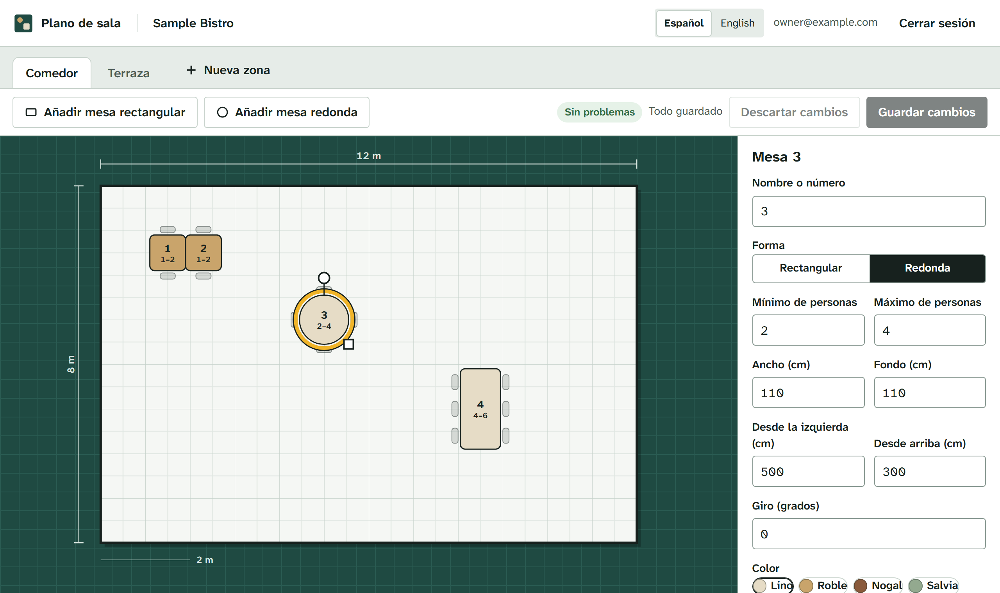
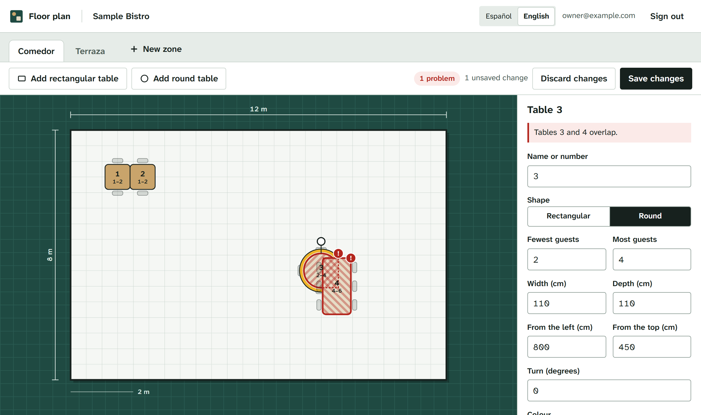
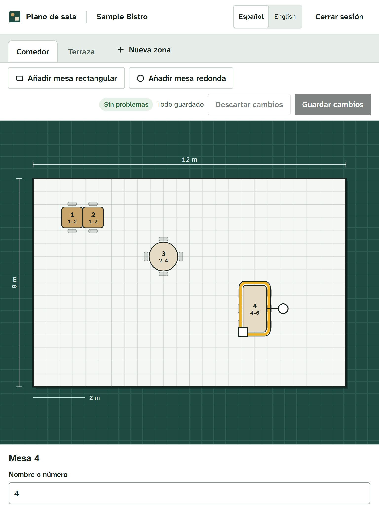

# floorplan-reservations

Table reservations for restaurants, where the venue draws its own floor plan and the booking engine works from that plan.

[Leer en español](README.es.md)

> **Status: early.** The API can take a booking, the database refuses double bookings, and owners draw their floor plan in a browser editor. Public bookings respect opening hours, a booking horizon and per-address limits. Staff sign in with a password, and only a venue's owners can change the plan. There is no booking page or staff screen yet. See the [roadmap](#roadmap).



## Why

Many open-source booking tools treat tables as a list: "table 4, seats 4". Real rooms aren't lists. Two small tables next to each other can be pushed together for a group of four, and you lose a seat or two when you do. A table near the door might only be good for walk-ins.

So the idea here is:

- **The plan is the source of truth.** Each venue places its tables (position, size, shape, rotation, zone, look), and the engine reads that same data. If the plan says two tables touch, the engine can join them.
- **No double bookings, enforced by the database.** Not by an "if" in the code that two requests can race past, but by a PostgreSQL constraint, with tests that fire bookings at it concurrently.
- **Several languages from the start.** Guests book in their language and get messages in it. Staff screens default to Spanish, with English available.
- **Self-hosted.** One `docker compose up` and it runs. No per-cover fees.

Out of scope: orders, kitchen screens, point of sale.

## What's in it today

- `packages/engine`: booking rules with no database or network code, so they're quick to test.
  - `validateZone` checks a floor plan for tables that overlap, stick out of the room or have impossible seat counts. It takes rotation into account.
  - `durationFor` says how long a party keeps a table, based on its size.
  - `seatingOptions` lists where a party could sit, best first: the smallest single table that fits, otherwise neighbouring tables pushed together.
  - `canStillSeat` says whether tables a party already holds still give it room after the plan changes.
  - `acceptsArrival` says whether a guest may arrive at a given local date and time, from the weekly hours and special days.
- `apps/api`: a [Fastify](https://fastify.dev/) API in TypeScript.
  - `GET /venues/:slug/floor-plan` returns the zones and tables, plus any problems the engine finds in the plan.
  - `POST /venues/:slug/reservations` books a table. The engine picks the table (or tables), and how long it is kept depends on the party size. It answers `409` when nothing is free. See [limits on public bookings](#limits-on-public-bookings).
  - `GET` and `PUT /venues/:slug/booking-rules` read and replace how far ahead guests may book and the opening hours.
  - Floor plan editing: `POST /venues/:slug/zones`, `PATCH` and `DELETE /venues/:slug/zones/:zoneId`, `POST /venues/:slug/zones/:zoneId/tables`, `PATCH` and `DELETE /venues/:slug/tables/:tableId`. See [editing the plan](#editing-the-plan).
  - Staff sign-in: `POST /auth/login`, `POST /auth/logout` and `GET /auth/me`. See [staff accounts and sign-in](#staff-accounts-and-sign-in).
  - `GET /health` checks that the API can reach the database.
  - `GET /openapi.json` describes the API (OpenAPI 3.1).
- `apps/web`: the [floor plan editor](#the-floor-plan-editor) for staff, in React and TypeScript, built with Vite. The API serves it at `/`.
- `npm run staff`: the command line that creates the first owner and manages staff accounts.
- `db/migrations`: the schema, as plain SQL files. A small runner applies them in order, each in a transaction, behind a lock so two copies of the app can't migrate at the same time.
- `db/seed/sample.sql`: a made-up venue to play with.

## Run it

### With Docker

You need Docker with Compose.

```bash
docker compose up --build
```

Then load the sample venue, create an owner for it (it asks for a password) and open <http://127.0.0.1:3000> to sign in to the editor:

```bash
docker compose exec api node apps/api/dist/seed-cli.js
docker compose exec api node apps/api/dist/staff-cli.js add --venue sample-bistro --email you@example.com --role owner
```

### With Node and your own PostgreSQL

You need Node 24 or newer and PostgreSQL. CI tests against PostgreSQL 18; older versions may work but are not tested.

```bash
cp .env.example .env    # then edit the two database URLs
npm install
npm run db:migrate
npm run db:seed
npm run staff -- add --venue sample-bistro --email you@example.com --role owner
npm run dev       # the API on http://127.0.0.1:3000
npm run dev:web   # the editor on http://127.0.0.1:5173, reloading as you change it
```

`npm run build` builds the API and the editor; after that, the API serves the editor itself at <http://127.0.0.1:3000>.

## Tests and checks

```bash
npm run check
```

That runs Prettier, ESLint, the TypeScript compiler and the tests. The API tests need a real PostgreSQL database: set `TEST_DATABASE_URL` in `.env`. **The tests wipe that database**, so they refuse to run unless its name ends in `_test`. With Docker Compose, a `floorplan_test` database is created the first time the database volume is made. If your volume is older than that, create it with `docker compose exec db createdb -U floorplan -O floorplan floorplan_test`.

The editor's tests (Vitest with Testing Library, in a simulated browser) run with the rest. The browser tests are separate, because they need a real browser:

```bash
npx -w @floorplan-reservations/web playwright install chromium   # once
npm run e2e
```

They build everything, wipe the database in `E2E_DATABASE_URL` (its name must end in `_e2e`), load the sample venue with made-up accounts, start the real API and drive Chromium through it: signing in, moving tables with the keyboard and the mouse, turning and resizing them, the refusals from the API, zones, the read-only view for staff, an accessibility check with [axe](https://github.com/dequelabs/axe-core) and a check that the content security policy blocks nothing.

CI runs the same checks on every pull request against PostgreSQL 18. The browser tests run in a job of their own. Another job builds the Docker image, starts it with Compose and calls the API and the editor.

## How the plan is stored

- Units are centimetres.
- A table's `x` and `y` are the position of its **centre** inside its zone, measured from the zone's top-left corner. Rotation is in degrees, clockwise.
- `style` is free-form JSON for the plan editor (colours and the like). The booking engine never reads it.
- One reservation can take several tables (`reservation_tables`), for groups seated at tables pushed together.

## Staff accounts and sign-in

Guests book without an account. Staff sign in with their e-mail address and a password, and changing a venue needs an account with the right role **at that venue**.

- **Roles.** `owner` may change the floor plan and the booking rules. `staff` is for the coming staff screen (today's bookings) and may not change either. One account can run several venues, with a different role at each.
- **Who may do what.** Every plan editing route and `PUT /venues/:slug/booking-rules` answer `401` without a session and `403` when the account is not an owner of that venue. Reading the plan, reading the rules and booking stay open to everyone. A role taken away stops working on the very next request.
- **First account.** There is no default user and no password in the code. Create the first owner from the command line; it asks for the password twice without showing it:

  ```bash
  npm run staff -- add --venue sample-bistro --email you@example.com --role owner
  ```

  With Docker: `docker compose exec api node apps/api/dist/staff-cli.js add --venue sample-bistro --email you@example.com --role owner`. The same command adds an existing account to another venue or changes its role. Other commands: `password` (new password, signs the account out everywhere and unlocks it), `remove` (takes the account off a venue), `sign-out` (ends all its sessions), `unlock` (lets a locked address sign in again) and `list`. Run `npm run staff` to see them all. In a script, pipe the password in on standard input, one line per question; never pass it as an argument.

- **Passwords** must have 12 to 200 characters. They are stored as scrypt hashes, each with its own random salt, and checked in constant time.
- **Signing in.** `POST /auth/login` with `{ "email", "password" }` sets the session cookie. `GET /auth/me` says who is signed in and which venues they run. `POST /auth/logout` ends the session.
- **Sessions** live in PostgreSQL, which only keeps a SHA-256 of each token. A session ends after 12 hours without use and 30 days after sign-in at the latest. Signing in again in the same browser replaces the old session, and a new password ends every session of the account.
- **The cookie** is `__Host-floorplan_session`: `HttpOnly` (page scripts can't read it), `Secure` (HTTPS only; browsers also accept it on `http://localhost`) and `SameSite=Strict` (other sites can't send it). Requests that a browser marks as started by another site (`Sec-Fetch-Site: cross-site` or `same-site`) are refused with `403` on every route that needs a session, and on sign-in. That includes another subdomain of the same site: a staff screen must be served from the same origin as the API (or through a reverse proxy that makes it so).
- **Failed sign-ins.** A wrong password and an unknown address get the same answer, and take about as long. After 10 failed attempts for one address in 15 minutes, that address gets `429` until the 15 minutes are over, even with the right password. The count is kept in PostgreSQL per address, whether or not it has an account, so it works across several copies of the API and gives nothing away. Each network address can also send 30 sign-in requests every 15 minutes (`LOGIN_RATE_LIMIT_MAX` and `LOGIN_RATE_LIMIT_WINDOW_MINUTES`). Someone who knows a staff member's address can keep that address locked out by failing on purpose; lift the lock with `npm run staff -- unlock --email <address>`. `TRUST_PROXY` matters here too. A successful sign-in clears the count. At most 16 password checks run at the same time across the whole API (each needs 32 MiB); more get `503` with `Retry-After`.
- **Not yet:** signing in with a link by e-mail (it comes when the API can send e-mails), two-factor codes, and managing staff from a screen.

## Editing the plan

Owners of a venue can add, change and remove its zones and tables through the API: position, size, shape, rotation, style, zone and whether the table can be booked online.

- Every change is checked with `validateZone` against what is stored. A change that would make a table overlap another one, stick out of its zone or have impossible seats is refused with `422` and the list of problems. Problems the plan already had don't block unrelated edits.
- Changes never leave an upcoming reservation without room. Taking away seats it needs, moving the tables it holds together apart, making one of them round or moving one of them to another zone is refused with `409`. A table booked on its own can still be moved, even to another zone: the party keeps it.
- Marking a table as not bookable never breaks a booking: bookings already made keep it, new ones go elsewhere.
- A venue can have up to 50 zones and a zone up to 200 tables.
- Refusals carry a `code` next to the English `error` sentence (`plan_invalid`, `upcoming_reservations`, `reservations_without_room`, `duplicate_label`, `duplicate_name`, `limit_reached`, `changed_while_saving`, `not_found`) and, for bookings in the way, a `count`. The editor turns them into its own language.
- A table with an upcoming reservation can't be removed. A table that was only booked in the past is **retired** instead of deleted: it leaves the plan and the engine, and old reservations still point at it. Its label is free again. Removing a zone works the same way for all its tables.
- Edits to the same zone take turns (they lock the zone, then the tables). A booking that had to wait for an edit of its tables reads the plan again before it is saved, so it can't land on a table that just lost its seats or stopped being bookable.

## The floor plan editor



A screen for the venue's owners to draw their rooms. Staff can open it too, read-only.

- **Drawn to scale** in SVG, one unit per centimetre, with the room's measurements along its edges and a scale bar. Tables show their seats as chairs around them.
- **Mouse:** drag a table to move it (it snaps to 5 cm; hold Alt to place it freely), the round handle turns it in 15° steps, the square handle resizes it from its centre.
- **Touch screens** (a tablet at the pass): a finger drags a table, and the handles grow so a finger can grab them (44 px). A finger on the free space around the tables scrolls the page as usual, so the side panel under the plan is easy to reach. Every button and field is at least 44 px tall on a touch screen, and the plan is only as tall as the room's shape needs.
- **Keyboard:** Tab goes from table to table, the arrows move the selected one by 5 cm (50 cm with Shift), R turns it, Delete removes it, Escape lets go. Every table has a full name for screen readers ("Table 3, round, for 2 to 4, 500 cm from the left…"), and moves are announced.
- **The side panel** edits everything the API stores: name, shape, seats, size, position, turn, colour and whether it can be booked online. With no table selected, it edits the zone. Zones are created, renamed, resized and deleted from there too.
- **Problems show as you work.** The editor runs the same `validateZone` as the API on every change: overlapping tables are hatched in red, with the exact area where they meet, and listed with a link to each table.
- **Nothing is saved until you press Save.** Saving sends only what changed, one table at a time. If the API refuses something (a table with an upcoming booking, a move that would leave a party without room), the message says which table and why, in the editor's language, and that change stays on screen to fix. A table that cannot be removed goes back on the plan. Moves that only fail because another table hasn't moved out of the way yet are tried again after the others. The browser asks before you leave with unsaved changes.
- **Languages:** Spanish first, English as the fallback for anything not translated. Every text lives in `apps/web/src/i18n`; a lint rule refuses words written straight into the components, and a test checks Spanish has every English text.
- **Accessibility:** visible keyboard focus, labels on every field, colours checked for contrast (table names pick dark or white text to stay above 4.5:1; the yellow selection ring has an ink edge so it stands out from the floor), handles you grab are at least 24 px with a mouse (WCAG 2.2 target size), and everything a drag does can also be typed in the side panel. The browser tests run axe on the sign-in page and the editor, and drive the editor on a touch tablet.
- **The session ending** opens a sign-in dialog over the editor. It cannot be closed with Escape, because leaving it would lose what was not saved.



### Sign-in cookies in development and in production

The session cookie is `__Host-`, `Secure` and `SameSite=Strict`, and the API turns away requests a browser marks as coming from another site. So the editor must come from the **same origin** as the API:

- **In production** the API serves the built editor itself (`apps/web/dist`, or the folder in `WEB_DIR`), so there is one address and nothing to configure: no CORS, no relaxed cookie. The pages get a strict content security policy (only files from the same address, no inline scripts, no framing). The Docker image includes the editor.
- **In development** Vite serves the editor on port 5173 and passes `/auth`, `/venues` and `/health` on to the API (`API_URL`, `http://127.0.0.1:3000` by default). The browser only ever talks to Vite, so to it the cookie is same-origin as well. Browsers accept `Secure` cookies on `http://localhost` and `http://127.0.0.1`, so this works without HTTPS.

## How double bookings are stopped

- Each reservation has its time as a range, `[start, end)`. A booking that ends at 21:30 and one that starts at 21:30 don't overlap.
- `reservation_tables` keeps a copy of that range and of whether the reservation still holds its tables (cancelled and no-show ones don't). The copy is part of the foreign key to the reservation with `on update cascade`, so moving or cancelling a reservation updates it in the same statement.
- An exclusion constraint (`btree_gist`) refuses two rows for the same table whose ranges overlap. It holds whatever code writes to the database.
- The API reads the free tables, books the best option and, if another request got there first, rolls back to a savepoint and tries again. Requests that want the same table wait their turn, so they don't stall each other.
- The tests hold back writes until every request in a burst has read the free tables, then release them at once: 25 requests for one table give exactly one booking.

Joining tables: only rectangular tables in the same zone, standing side by side (gap of 5 cm or less) and not turned at an angle. At most three, and every one of them must be needed.

Durations use the sample rules in `durationFor` for every venue for now.

## Limits on public bookings

Booking needs no account, so the endpoint protects itself:

- **Opening hours.** Each venue stores arrival windows: the first and the last time a guest may arrive, in the venue's own time zone, so 20:00 stays 20:00 when the clocks change. Windows repeat every week; a window can run past midnight (20:00 to 00:30). **Special days** (a holiday, a week off, a New Year's Eve dinner) replace the weekly hours of that date; a special day with no windows is closed. Bookings outside the hours get `422`. Arrival times count to the minute: 15:30:45 counts as 15:30. A venue that hasn't set any hours takes no online bookings.
- **Horizon.** Guests can book from today up to `horizonDays` ahead (60 by default, at most 730), counted in the venue's calendar days. Further ahead gets `422`.
- **One booking per guest at a time.** A second booking at the same venue with the same e-mail (any letter case) or the same phone (any spacing) that overlaps one the guest already holds gets `409`. That catches a double click on "Book" and one person taking several tables for the same evening. Simultaneous clicks queue up per guest, so exactly one gets through. Only the same e-mail or the same phone digits match: a guest who books once with an e-mail and once with only a phone, or writes the country code once and not the other time, is not caught. Contact details aren't verified yet, so someone who knows a guest's e-mail can book with it first; e-mail confirmation comes with the booking page.
- **Requests per address.** Each address can send 10 booking requests every 15 minutes (set with `BOOKING_RATE_LIMIT_MAX` and `BOOKING_RATE_LIMIT_WINDOW_MINUTES`); after that it gets `429` with `Retry-After`. Failed requests count too. An IPv6 `/64` counts as one address. The counts live in the API's memory, so each copy of the API counts on its own and a restart resets them. Guests behind one shared address (a mobile carrier, the venue's own Wi-Fi) share one limit. There is no cap per venue yet.
- **Behind a proxy**, set `TRUST_PROXY` to the proxy's address (for example `127.0.0.1`). Otherwise every guest looks like the proxy and they all share one limit. `X-Forwarded-For` is only believed from the addresses listed there. With Docker Compose, the API sees the proxy through Docker's network (an address such as `172.17.0.1`), not as `127.0.0.1`: list that address or range instead.

Owners set the rules with `PUT /venues/:slug/booking-rules`, which replaces them all at once. Bookings already made are kept even if they now fall outside the hours.

## Roadmap

1. ~~**Booking engine with no double bookings.**~~ Done.
2. ~~**Floor plan editor.** API to edit zones and tables, checked by the engine, and the screen to draw them.~~ Done.
3. **Public booking page.** Several languages (including right-to-left), suggests nearby times when the one asked for is full, GDPR-friendly.
4. **Staff screen.** Today's service, confirm, cancel, seat, email notices.
5. **Deployment guide.** Backups and running it for a real venue.

## Stack

Node 24, TypeScript, Fastify, PostgreSQL 18, React 19, Vite, Vitest with Testing Library, Playwright with axe, ESLint, Prettier, Docker Compose, GitHub Actions.

## License

[MIT](LICENSE)

Built by [babylonace](https://github.com/babylonace). AI-assisted.
